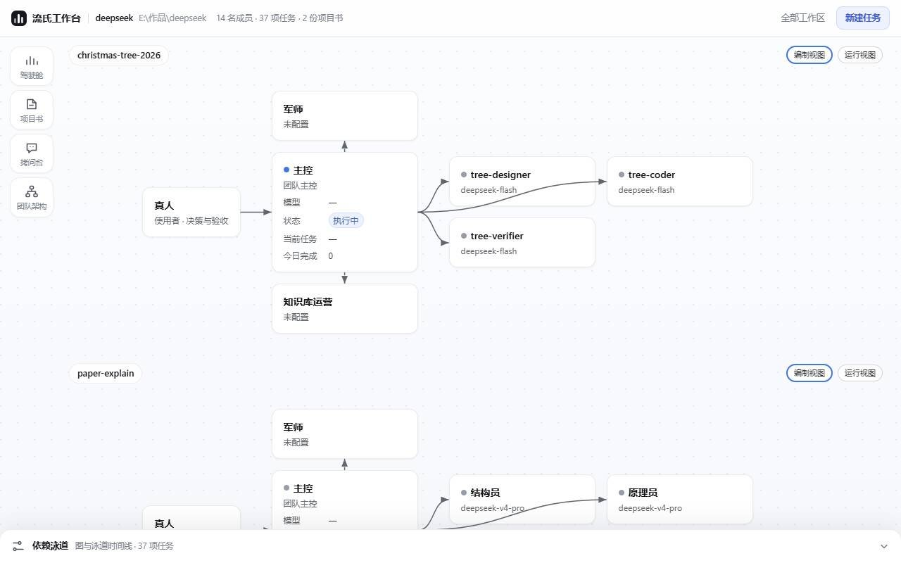
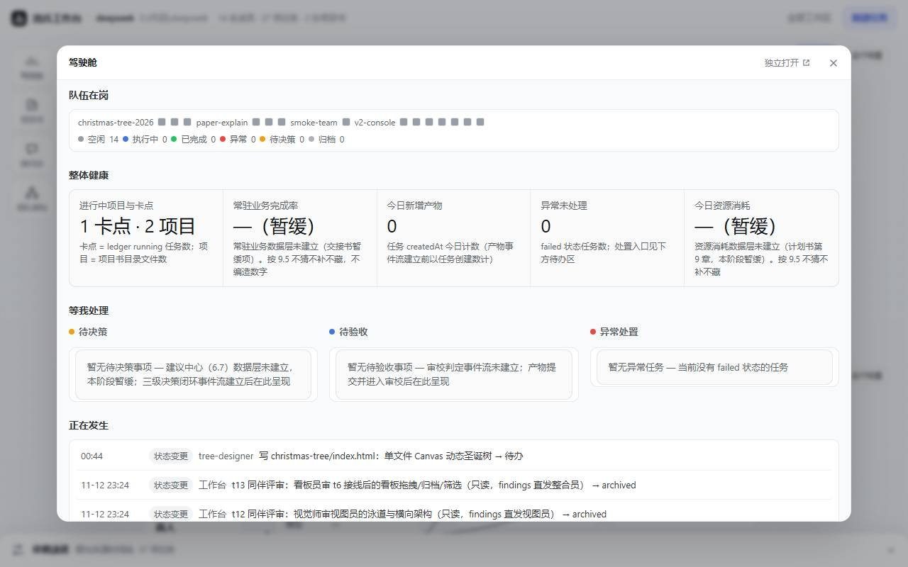
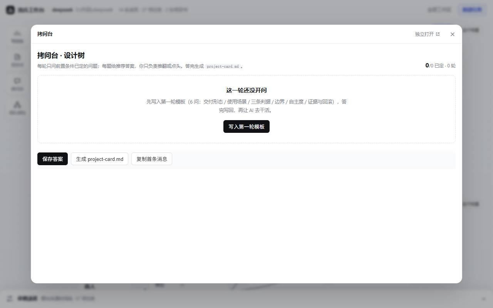
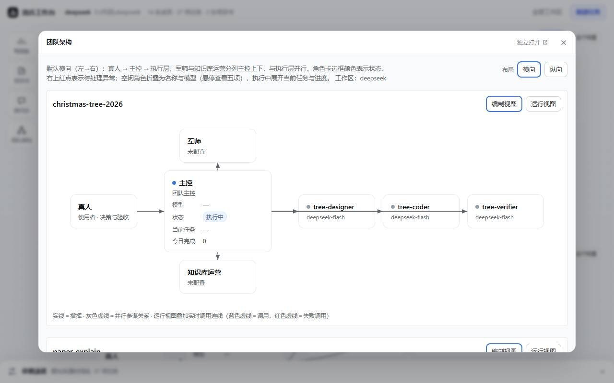

# 流氏工作台 · dsh-team-console

给 DSH（DeepSeek Harness）里的多智能体团队做的一块**本地画布**：团队关系图铺满整页，左上角四枚方块切换视图，底部抽屉拉开就是依赖泳道。零 npm 依赖，只监听 `127.0.0.1:8787`。



---

## 它解决什么

多智能体跑起来之后，真正难的是三件事：

1. **谁在干什么** —— 团队里每个角色、模型、当前任务、今天完成多少；
2. **卡在哪** —— 任务之间的依赖、并行/串行关系、哪一步返工；
3. **该你拍板什么** —— 待决策、待验收、异常，集中在一屏。

流氏工作台把这三件事压到一张画布上：**关系图打底，面板浮在上面**，不来回跳页。

---

## 界面

### 画布首页

- 点阵画布 + 当前团队的关系图（真人 → 主控 → 执行层，军师/知识库运营在上下并行）；左上角团队名 chip 点开是团队下拉，选中即切换、菜单自动收回，选择记在 `localStorage`；
- 团队名默认走中文映射（`team-labels.json`），没有映射的团队显示原名；
- 左上四枚方块：**驾驶舱 / 项目书 / 拷问台 / 团队架构**，点开是浮层，`独立打开` 可变成独立页；
- 底部一条 46px 的**依赖泳道**抽屉，点一下展开/收起，状态记在 `localStorage`；
- 顶栏：工作区切换、成员/任务/项目书统计、全部工作区、新建任务。

### 驾驶舱

队伍在岗、五项指标、待办与动态流。数字缺数据源时显示「暂缓」，不猜、不补、不编。



### 项目书

左列书脊（名称 / 日期 / 大小），右侧直接读 Markdown 原文：标题、列表、引用、代码块、表格、粗体、行内代码、链接。文件改动后刷新即最新。


### 拷问台

把「需求还没想清」的部分做成设计树：每轮只问前置条件已定的问题，每题给推荐答案，答完落成 `project-card.md`，再交给 Agent 去干。



### 团队架构

每个团队一块：编制视图 / 运行视图切换，横向或纵向布局；卡片显示角色、模型、状态、当前任务，连线是指挥与并行参谋关系。



### 依赖泳道

任务依赖图 + 泳道时间线，按团队分页；可切「显示关系 / 全局 / 按小时 / 事件」。


---

## 快速开始

要求：**Node.js ≥ 20**（只用内置模块，零依赖）。

```bash
# Windows / macOS / Linux 通用
node core/serve-workbench.mjs <你的工作区路径> --port=8787

# Windows 也可以直接双击
core\重开工作台.bat
```

然后打开 <http://127.0.0.1:8787/>。

首次启动会在 `%USERPROFILE%\.dsh\team-console\board.json`（或 `$DSH_HOME/team-console/board.json`）建本地任务库，并从 `.agent-teams` 与全局账本导入一次；之后任务状态只写这份 `board.json`。

> 只想看示例数据：`--demo`。想换存储位置：`WORKBENCH_BOARD=<path>`。想关掉账本镜像：`--no-mirror-ledger`。

---

## 路由

| 路径 | 说明 |
|---|---|
| `/` | 画布首页（团队关系图 + 四枚方块 + 底部抽屉） |
| `/cockpit` | 驾驶舱 |
| `/projects` | 项目书书架 + 阅读器 |
| `/grill` | 拷问台 |
| `/team` | 团队架构（`?pane=1` 为右侧窄栏版） |
| `/deps` | 依赖泳道 + 泳道时间线 |
| `/kanban` | 任务看板（三态） |
| `/spaces` | 全部工作区索引 |
| `/api/health` | `{ ok, server, v, pid, workspaces }` |
| `/api/data` | 当前工作区的汇总数据 |
| `/api/projects` `/api/project?id=` | 项目书列表 / 原文 |
| `/api/grill` | 拷问台轮次读写 |
| `/api/action` | 新建/更新任务 |

`embed=1` 用于嵌进浮层或 DSH 侧栏（去导航、去多余留白）；`canvas=1` 是画布专用的团队图样式；`pane=1` 是右侧栏窄版。

---

## 数据从哪来

- 团队与任务：`<workspace>/.agent-teams/*/team.json`、`inbox/*.jsonl`；
- 项目书：`<workspace>/项目书/*.md`（排除 `_模板.md`）；
- 任务状态：本地 `board.json`（DSH 任务账本只做首次导入与可选镜像，不做运行时依赖）。

工作台**只读**团队与项目文件，不写工作区；所有写入都落在自己的 `board.json`。

---

## 目录结构

```text
core/
  serve-workbench.mjs      # HTTP 服务与路由
  team-data.mjs            # 任务 / 团队装载
  store.mjs                # board.json 读写、账本导入、镜像
  workspaces.mjs           # 工作区发现与解析
  team-labels.json         # 团队中文名映射（按 id 或原名）
  views/
    canvas.mjs             # 画布首页
    cockpit.mjs            # 驾驶舱
    projects.mjs           # 项目书
    grill.mjs              # 拷问台
    team-arch.mjs          # 团队架构
    dep-swim.mjs           # 依赖泳道
    kanban.mjs             # 三态看板
    spaces.mjs             # 全部工作区
    shell.mjs              # 公共样式覆盖（嵌入模式 / 画布 / 窄栏）
  styles/v2.css            # 设计令牌与基础组件
  重开工作台.bat
skill/dsh-team-console/    # 可安装的 DSH 技能包（自带同一份 core）
scripts/                   # 启动脚本（bat / sh）
```

---

## 设计说明

- 主色 `#4d6bfe`，页面底色 `#f7f9fc`，点阵网格 24px，圆角 14–16px，正文 14px/1.55；
- 一页只留一个视觉重点（关系图），面板全部是浮层，避免多页来回切；
- 卡片默认克制：1px 细边、极浅阴影，hover 才抬升；
- 兼容 `prefers-reduced-motion`；iframe 与抽屉都懒加载。

---

## 作为 DSH 插件

仓库自带的是**独立控制台**。若想让它出现在 DSH 左侧菜单和对话右侧栏，需要另一个薄插件 `dsh-workbench`（不在本仓库）：

- 入口用 `sidebar.panellist` 注册，页面用 `main` 槽注册，`key` 对齐；
- 右侧栏用 `sidebar.right.pane.tab` 注册「团队架构」，指向 `/team?embed=1&canvas=1&pane=1`；
- 插件启动时用 `/api/health` 的 `v` 判断端口上是不是新版，不匹配就替换旧进程。

---

## 开发

```bash
node --check core/serve-workbench.mjs
node --check core/views/*.mjs
node core/serve-workbench.mjs <workspace> --port=8794
```

改 `.mjs` 后重启进程即可，无构建步骤。

---

## License

MIT
