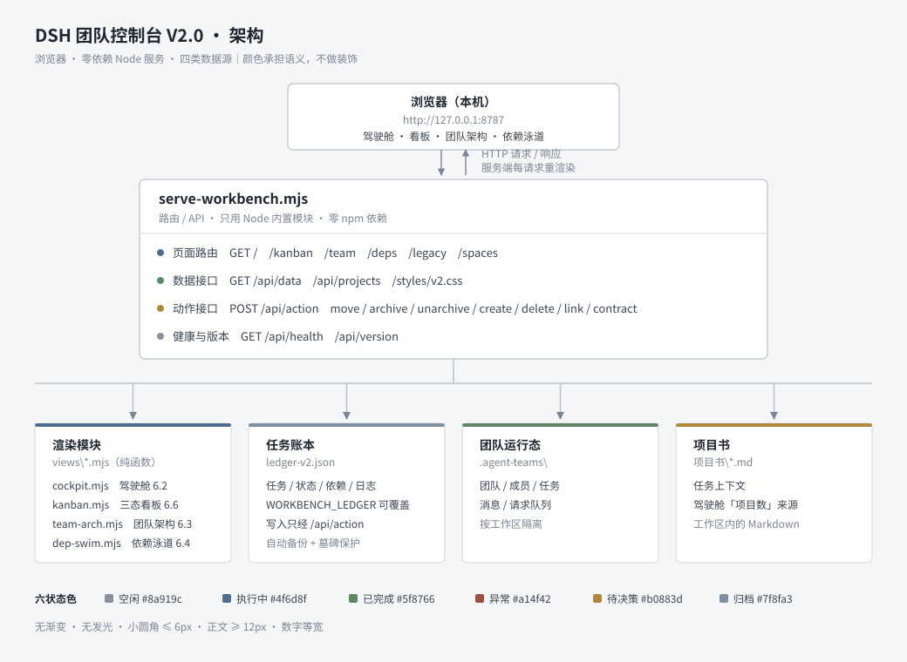

# DSH 团队控制台 V2.0

> **给多智能体团队用的本地可视化控制台：驾驶舱 / 三态看板 / 团队架构 / 依赖泳道。**

**零 npm 依赖** · **Node.js ≥ 20** · **本地 8787** · **MIT**

打开一个网页，就知道团队里谁在干什么、哪里卡住、哪一步返工、今天该你拍板什么。

---

## 四屏一览

> 下面四张是 V2.0 的四个主页面（1280×800），分别对应 `/`、`/kanban`、`/team`、`/deps` 四个真实路由。

### 01 · 总览驾驶舱（`/`，默认落地页）

<!-- 待补截图：images/01-cockpit.png —— 1280×800，状态区 / 指标区 / 待办区 / 动态流 -->

**看什么：** 一行角色方块看队伍在不在岗；五个指标看整体健康度；待办区直接处理异常；动态流看正在发生什么。

### 02 · 三态任务看板（`/kanban`）

<!-- 待补截图：images/02-kanban.png —— 1280×800，长期任务池 / 进行中 / 归档三栏 + 三组筛选 -->

**看什么：** 任务卡在「长期任务池 → 进行中 → 归档」之间拖拽即改状态；归档必须写一句话说明；悬停卡片展开摘要与最近日志。

### 03 · 团队架构视图（`/team`）

<!-- 待补截图：images/03-team-arch.png —— 1280×800，真人 → 主控 → 执行层，军师与知识库运营在主控两侧 -->

**看什么：** 角色卡边框颜色即状态，右上红点即待处理异常；「编制视图 / 运行视图」一键切换，节点位置不变。

### 04 · 依赖图 + 泳道时间线（`/deps`）

<!-- 待补截图：images/04-dep-swim.png —— 1280×800，上方依赖图 + 下方角色泳道，点击节点联动定位 -->

**看什么：** 方块节点与状态色条；连线方向即依赖、粗细即数据量、虚线即跨角色、红色虚线即失败/打回；点一个节点，下方泳道定位到对应执行区间。

---

## 架构



```text
[浏览器]  http://127.0.0.1:8787
    |  GET /  /kanban  /team  /deps  /legacy  /spaces
    |  GET /api/data  /api/projects  /styles/v2.css
    |  POST /api/action  move/archive/unarchive/create/delete/link/contract
    v
[serve-workbench.mjs]  路由 + API（零 npm 依赖，Node 内置模块）
    |-- views/*.mjs        驾驶舱 / 三态看板 / 团队架构 / 依赖泳道（纯渲染函数）
    |-- ledger-v2.json     任务账本（WORKBENCH_LEDGER 可覆盖）
    |-- .agent-teams/      团队 / 成员 / 任务 / 消息
    `-- 项目书/*.md         任务上下文与项目数
```

- **单进程、零依赖**：只用 Node 内置的 `http` / `fs` / `path` / `zlib` 与同目录的 `.mjs` 模块，不需要 `npm install`，没有构建步骤。
- **服务端渲染**：每个请求重新渲染；四个视图模块导出纯函数 `renderXxx(opts)`，`opts` 与 `GET /api/data` 同构。
- **写操作收口**：页面不直接改账本文件，所有状态变更都走 `POST /api/action`；账本写入带备份与墓碑保护。
- **多工作区**：用 `?ws=<id|标题|路径>`、`?sid=<会话>` 或工作区登记表解析当前工作区。

---

## 它解决什么问题

多智能体团队真正贵的不是「智能体不够强」，而是**看不清**：谁在跑、卡在哪个依赖、哪一步返工了、今天该你决定什么。V2.0 把这些问题收进一个本地工作台，四个页面各回答一个问题：

| 页面 | 回答的问题 | 适合什么时候看 |
|---|---|---|
| 总览驾驶舱 | 队伍在不在岗？今天要不要我介入？ | 每天打开控制台的第一眼 |
| 三态任务看板 | 任务堆在哪一栏？谁在做什么？ | 派活、拖动状态、清理归档 |
| 团队架构视图 | 组织关系对不对？谁在空闲、谁有异常？ | 配置团队、排查执行异常 |
| 依赖图 + 泳道 | 卡在哪个依赖？哪一步返工了？ | 复盘执行过程、定位拖慢的环节 |

---

## 功能说明

### 6.2 总览驾驶舱（默认落地页）

- **状态区**：一行横条呈现全部角色，每个角色一个小方块，颜色 = 六状态色；悬停显示当前任务名。
- **指标区**：进行中项目数与卡点数 / 常驻业务完成率 / 今日新增产物数 / 异常未处理数 / 今日资源消耗。项目数来自 `项目书\*.md` 的实际文件数；异常未处理 = `failed` 状态任务数。
- **待办区**：待决策、待验收、异常处置三类，可直达处理；异常处置行内可直接重试或标记完成，不需要先跳转到项目页。
- **动态流**：按时间倒序展示最近 20 条关键事件，每条包含时间、角色、事件类型与一句话摘要；来源为任务创建/更新与团队消息。
- **数据缺失时如实标注**：常驻业务完成率、今日资源消耗显示「—（暂缓）」并注明数据层未建立；待决策、待验收给出空态原因，不编造数字。

### 6.6 三态任务看板

- **三栏**：左侧长期任务池（`backlog` / `todo` / `failed`）、中间进行中（`running`）、右侧归档（`archived` / `done`）。
- **拖拽即状态变更**：跨栏拖放立即写账本，不需要额外确认；拖入归档栏会强制弹窗填写一句话归档说明（1–200 字，说明为空不发请求）。
- **任务卡三行**：任务名 + 负责人 / 进度条 + 剩余预估 / 标签；悬停展开任务摘要与最近一条日志，不改变布局。
- **三种筛选**：按项目、按角色、按状态，筛选状态以顶部标签显示，随时可取消。
- **归档可见**：归档卡弱化显示；`failed` 卡以异常色呈现并留在任务池，避免异常被「藏」进归档。

### 6.3 团队架构视图

- **层级布局**：真人 → 主控 → 执行角色；军师与知识库运营分居主控两侧，与执行层并列。
- **角色卡五项**：角色名 / 绑定模型 / 当前状态 / 当前任务名 / 今日完成数；边框颜色 = 状态，右上小圆点 = 存在待处理异常。
- **折叠展开**：空闲角色只显示名称与模型；执行中角色展开当前任务与进度。
- **双模式**：编制视图只看组织关系；运行视图叠加实时调用连线，看清此刻谁在调用谁。两种模式共用布局，切换不改变节点位置。
- **缺配置不编造**：未配置军师 / 知识库运营 / 执行成员时画占位槽并标「未配置」。

### 6.4 依赖图 + 泳道时间线

- **同页上下排布并联动**：点击依赖图节点，下方泳道定位并高亮该任务对应的执行区间。
- **依赖图**：方形节点内显示任务名与状态色条；连线方向 = 依赖关系，粗细 = 数据量，虚线 = 跨角色调用，红色虚线 = 失败或被打回的调用。被打回任务叠加回退角标（数字 = 次数，点击展开原因；无日志数据则不显示）。
- **泳道时间线**：纵轴 = 角色，横轴 = 时间；执行区间横条颜色与依赖图节点一致；返工区间用斜纹填充；采纳军师建议处叠加标记，悬停显示建议摘要（无数据不显示）。
- **三种视野**：全局 / 按小时 / 事件，共用同一份数据，切换只改变刻度，不改变内容。

### 6.10 视觉规范

全站遵循同一套视觉约束：**无渐变、无发光、无高饱和背景**；颜色承担语义，不承担装饰；正文无衬线且不小于 12px；数字使用等宽字形；全站小圆角（≤ 6px）。

| 状态 | 色值 | 语义 |
|---|---|---|
| 空闲 | `#8a919c` | 中性浅灰，在岗但没跑任务 |
| 执行中 | `#4f6d8f` | 沉静蓝，正在执行 |
| 已完成 | `#5f8766` | 低饱和绿，交付完成 |
| 异常 | `#a14f42` | 砖红，仅用于真正需要处理的对象 |
| 待决策 | `#b0883d` | 琥珀，数量受控，避免满屏提醒 |
| 归档 | `#7f8fa3` | 浅灰蓝，明显弱化，不与活动对象竞争 |

### 本版边界（明确暂缓）

以下能力**不在 V2.0 本版**，界面不伪造入口或数字：

| 计划书 | 能力 | 本版状态 |
|---|---|---|
| 6.5 | 智能体详情面板 | 未纳入本版（本版落地范围为 6.10 / 6.2 / 6.6 / 6.3 / 6.4） |
| 6.7 | 建议中心 | **暂缓**：数据层未建立；驾驶舱「待决策」为空态并注明原因 |
| 6.8 | 知识库视图 | **暂缓**：数据层未建立 |
| 第 9 章 | 资源消耗与用量查询 | **暂缓**：数据层未建立；驾驶舱该项显示「—（暂缓）」 |

缺失数据按「不猜、不补、不藏」处理：显示短横线或「—（暂缓）」，并注明缺失原因。

---

## 快速开始

### 依赖

- **Node.js ≥ 20**（Windows / macOS / Linux）。
- **零 npm 依赖**：不需要 `npm install`，也没有构建步骤。
- 一个 DSH 工作区：包含 `.agent-teams\`、`项目书\`，并且任务账本可读。

### 启动（Windows）

1. 双击工作区里的 `team-view\重开工作台.bat`：它会清理残留测试任务、停掉 8787 旧进程、启动新服务并做健康检查（脚本默认打开 `/spaces` 工作区列表；选中工作区后可进入控制台，或直接访问 http://127.0.0.1:8787/）。
2. 或手动启动：

```bat
cd /d <workspace>\team-view
node serve-workbench.mjs "<workspace>" --port=8787
```

3. 打开 **http://127.0.0.1:8787**（默认驾驶舱）。

```bash
# macOS / Linux 同理
node team-view/serve-workbench.mjs "/path/to/workspace" --port=8787
```

> 8787 被旧进程占用时，页面会继续显示旧代码。用 `重开工作台.bat` 重启，或先结束监听 8787 的进程再启动。
>
> 本仓库是 V2.0 控制台的**展示与技能包仓库**（README / 架构图 / 成品截图 / 可安装技能包）。运行文件位于使用方工作区的 `team-view\` 目录；技能包只负责启动与排障，不重复分发实现文件。

### 装成 DSH 技能（可选）

把 `skill\dsh-team-console\` 复制到 `%USERPROFILE%\.dsh\skills\dsh-team-console`（macOS / Linux：`$DSH_HOME/skills/dsh-team-console`），重启 DSH 后即可用自然语言让智能体启动控制台。启动脚本会优先在 `<workspace>\team-view` 查找实现；实现目录另有位置时，设 `DSH_TEAM_CONSOLE_HOME` 指向它。

```bat
"%USERPROFILE%\.dsh\skills\dsh-team-console\scripts\start-workbench.bat" "D:\your-workspace" 8787
```

详见 [`skill/dsh-team-console/README.md`](skill/dsh-team-console/README.md)。

---

## 导航与端点

页面导航：**驾驶舱 | 任务看板 | 团队架构 | 依赖泳道**；旧版工作台保留在 `/legacy`。

| 方法 | 路径 | 说明 |
|---|---|---|
| GET | `/` | 总览驾驶舱（默认落地页） |
| GET | `/kanban` | 三态任务看板（长期任务池 / 进行中 / 归档） |
| GET | `/team` | 团队架构视图（编制 / 运行双模式） |
| GET | `/deps` | 依赖图 + 泳道时间线（同页联动） |
| GET | `/legacy` | 旧版工作台（兼容页） |
| GET | `/styles/v2.css` | V2.0 全局视觉规范样式表（`text/css`） |
| GET | `/api/data` | 主数据源：`{ ws, tasks, teams, links, projects }` |
| GET | `/api/projects` | 项目书文件名数组（驾驶舱指标区「项目数」） |
| POST | `/api/action` | 写操作入口，动作见下表 |

`POST /api/action` 支持的动作：

| action | 载荷（JSON） | 作用 |
|---|---|---|
| `move` | `{ action:"move", id, to }` | 改变任务状态；`to` ∈ `line` / `start` / `done` / `failed` / `backlog`（映射为 `todo` / `running` / `done` / `failed` / `backlog`） |
| `archive` | `{ action:"archive", id, note }` | 归档；`note` 必填（1–200 字），写入 `archiveNote` 与日志 |
| `unarchive` | `{ action:"unarchive", id, to? }` | 取消归档；缺省回 `backlog`，`to:"start"` 回 `running` |
| `create` | `{ action:"create", title, note?, backlog?, priority? }` | 新建任务；`backlog:true` 直接进长期任务池 |
| `delete` | `{ action:"delete", id }` | 删除任务（写墓碑，防止对账复活） |
| `link` | `{ action:"link", a, b, kind? }` | 记录任务关联；`kind` 为 `link` 或 `merge` |
| `contract` | `{ action:"contract", boardTaskId, goal, inputs, outputs, acceptance, iface, deps? }` | 写入任务契约与依赖 |

- 成功统一返回 `200 { ok: true, ... }`；失败返回 `{ ok: false, error: "人类可读原因" }`，页面在行内提示、不丢数据。
- 另有 `/api/health`、`/api/version`、`/spaces` 等辅助端点，完整路由以 `team-view\serve-workbench.mjs` 为准。
- 内部还保留 `dispatch` / `writeback` 两个动作，供 AgentTeams 派发与结果回写使用，页面主流程不直接调用。

---

## 数据来源

| 数据 | 默认位置 | 说明 |
|---|---|---|
| 任务账本 | `%USERPROFILE%\.dsh\task-board\ledger-v2.json` | 可用环境变量 `WORKBENCH_LEDGER` 指向其他账本（测试时务必这样隔离） |
| 团队运行态 | `<workspace>\.agent-teams\` | 团队、成员、任务、消息、请求队列 |
| 项目书 | `<workspace>\项目书\*.md` | 任务上下文；文件名数组同时用于驾驶舱「项目数」 |
| 工作区登记 | `%USERPROFILE%\.dsh\storages\workspace.json` | 多工作区切换与 `?ws=` 解析（可选） |

> 账本默认位于工作区之外。在受沙箱限制的会话里直接写账本文件可能报 `EPERM`；**所有写入都走 8787 的 `POST /api/action`**，需要测试时用 `WORKBENCH_LEDGER` 指向测试账本。

---

## 回滚

V2.0 改造前已备份原文件，并附带一键回滚脚本：

```text
team-view\v2-backup\        stage.mjs / serve-workbench.mjs / workbench.mjs 原文件备份
team-view\回滚V2.0.bat      一键还原备份并删除新增的 views\*.mjs、styles\v2.css 等文件
```

回滚步骤：

1. 结束监听 8787 的工作台进程（或直接运行回滚脚本后重启）。
2. 双击 `team-view\回滚V2.0.bat`。
3. 双击 `team-view\重开工作台.bat` 重新启动旧版工作台。
4. 打开 http://127.0.0.1:8787 确认已回到改造前界面。

---

## 目录结构

**展示仓库（本仓库）**

```text
.
├─ README.md
├─ LICENSE
├─ PUBLISH.md
├─ PUBLISH-CHECK.md
├─ .gitignore
├─ assets/
│  └─ architecture.svg
├─ images/
│  ├─ .gitkeep
│  ├─ 01-cockpit.png
│  ├─ 02-kanban.png
│  ├─ 03-team-arch.png
│  └─ 04-dep-swim.png
└─ skill/
   └─ dsh-team-console/
      ├─ SKILL.md
      ├─ README.md
      └─ scripts/
         ├─ start-workbench.bat
         └─ start-workbench.sh
```

**运行目录（工作区内）**

```text
<workspace>/team-view/
├─ serve-workbench.mjs        8787 服务（路由 / API）
├─ views/
│  ├─ cockpit.mjs             6.2 总览驾驶舱
│  ├─ kanban.mjs              6.6 三态任务看板
│  ├─ team-arch.mjs           6.3 团队架构视图
│  └─ dep-swim.mjs            6.4 依赖图 + 泳道时间线
├─ styles/v2.css              6.10 全局视觉规范
├─ v2-backup/                 改造前备份
├─ 重开工作台.bat              重启 8787
└─ 回滚V2.0.bat               一键回滚
```

---

## License

[MIT](LICENSE) © 2026 deepseek workspace

## 致谢

- 多智能体运行时与工作台生态由 **DeepSeek Harness** 提供。
- 信息架构、交互与视觉口径来自《DeepSeek Harness 智能体团队可视化控制台升级方案（V2.0）》第 6 章；六状态色与「无渐变、无发光、小圆角」规范在 `styles/v2.css` 中落地。
- 感谢所有愿意先把界面做清楚、再谈自动化的多智能体实践者。
